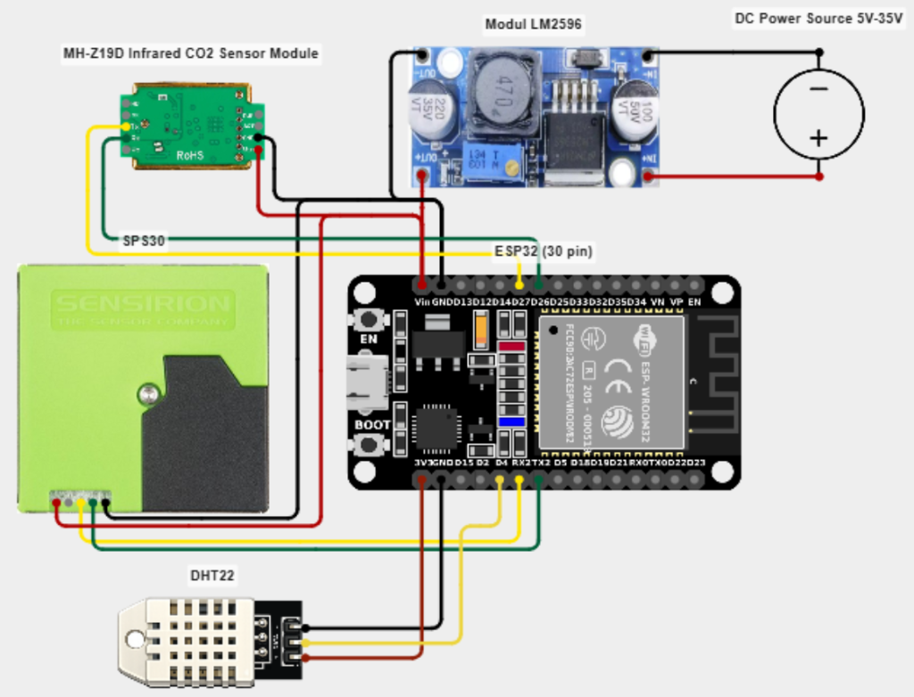

# AITALIM IoT

[](https://aitalim-iot.aashish1023.workers.dev)

**A cloud-connected environmental monitoring dashboard for air quality, GPS-enabled vehicles, and moss-water-tank systems.**



## Live app

Open the dashboard at [aitalim-iot.aashish1023.workers.dev](https://aitalim-iot.aashish1023.workers.dev).

## Highlights

- Real-time device dashboard for ESP32-connected hardware
- Air-quality telemetry with temperature, humidity, CO₂, particulate and sensor readings
- GPS vehicle tracking and location-aware views
- Moss-water-tank monitoring with remote pump and threshold configuration
- Device registration, per-device history, charting and pagination
- Remote device configuration with desired/reported state tracking
- Alert history for low-water events
- Responsive dark/light interface for desktop and mobile
- Session-protected administration controls

## Architecture

```text
ESP32 devices ── HTTPS JSON ──> Cloudflare Worker ──> Cloudflare D1
                                      │
                                      └──> Web dashboard / API
```

The deployed Worker serves the dashboard, implements the REST API, and persists readings in Cloudflare D1. It is available on a stable `workers.dev` address without a custom-domain renewal.

## Demo

[Download the hardware demo video](docs/demo.mp4)

The video shows the ESP32 environmental-monitoring hardware wiring used by the project.

## Repository layout

```text
cloudflare/
  worker.js          Cloudflare Worker API
  schema.sql         Cloudflare D1 schema
  public/            Safe static web assets deployed to Cloudflare
smart_carbon_monitor_FINAL/
  air_quality_monitior.ino
  moss.ino
  gps_tracker/       ESP32 firmware
docs/demo.mp4        Hardware demo video
```

## Firmware setup

1. Open the appropriate `.ino` file in Arduino IDE.
2. Replace `YOUR_WIFI_SSID` and `YOUR_WIFI_PASSWORD` with your own network values.
3. The `SERVER_URL` is already set to the live Worker URL.
4. Install the required ESP32 libraries, compile, and flash the device.

## Security

- No live credentials, API tokens, database passwords, or Wi-Fi passwords are stored in this repository.
- The Worker uses Cloudflare secrets for administrator credentials.
- Original legacy PHP/hosting files are excluded from the Cloudflare public asset bundle.
- Do not commit a real `iot_config.json`, `deploy.ps1`, or firmware containing Wi-Fi credentials.

## Deploying your own copy

See [DEPLOY.md](DEPLOY.md). The project uses Cloudflare Workers and D1; GitHub Pages cannot run the backend because it requires server-side APIs and database storage.
